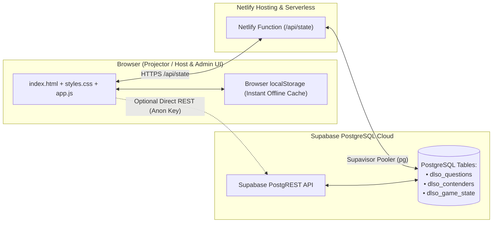

# 🎡 DLSO Benin Region — "Daniel on the Wheels"

A DLSO game on the Book of Daniel.

> **Interactive Christian Bible Quiz & Spinning Wheel Game Show Web Application**  
> Built for **DLSO (Deeper Life Student Outreach) Benin Region** • Powered by **Supabase PostgreSQL** & **Netlify**

---

## 📖 Overview

**Daniel on the Wheels** is a broadcast-style, projector-ready Christian Quiz Game Show application designed for student outreaches, regional Bible competitions, youth camps, and fellowship quiz events across the **DLSO Benin Region**.

The Game Show Host spins an interactive wheel loaded with **20 youth discussion questions** based on the Book of Daniel (plus special game show wedges). Each prompt invites an open-ended, scripture-based response, with a 90-second timer and one-click scoring controls for the contenders.

---

## ✨ Key Features

### 1. 🎡 High-Capacity Spinning Question Wheel
- **20 Youth Discussion Questions:** Covers conviction, integrity, excellence, courage, prayer, leadership, compassion, and lasting impact through Daniel's story.
- **Physics & Audio Engine:** Quartic ease-out deceleration with Web Audio API synthesized peg ticks, fanfare chimes, urgent countdown beeps, and buzzers (zero external MP3 dependencies).
- **Special Game Show Wedges:**
  - `🔥 2× MARKS` — Doubles the point value of the next question drawn.
  - `🎁 +5 BONUS` — Awards +5 free marks to the contender on the Hot Seat and grants another spin.
  - `🎡 FREE SPIN` — Grants an immediate extra spin.
- **Smart Filtering:** Spin across all questions or filter by the Daniel chapter connected to each discussion prompt.
- **Auto-Removal of Answered Questions:** Answered questions are automatically removed from the wheel so the pointer only lands on fresh questions (can be restored with one click).

### 2. 📦 Discussion Question Box (Directly Under the Wheel)
- **Open-ended prompts:** Each question includes its scripture reference and a projected host scratchpad for the response.
- **Host guidance:** The reveal panel reminds the host to award marks for a clear, relevant, scripture-based response.
- **Countdown Timer:** Visual progress bar + 90-second timer with `Start/Pause (T)` and `Reset` controls.
- **Host Scoring Action Bar:**
  - `✅ Correct! (+Full Marks)` — Awards full marks (or `2×` if Double Marks active), launches celebration confetti, marks the question complete, and rotates to the next contender.
  - `➗ Half Marks` — Awards 50% of the question's marks for partially correct short answers.
  - `❌ Incorrect (0 Marks)` — Records a missed attempt and advances the turn.
  - `↪ Pass / Bonus Attempt` — Passes the open question to the next contender with a 15-second bonus timer.

### 3. 🏆 Contenders Scoreboard & Championship Podium
- Track individual contenders, houses (*Daniel House*, *Hananiah House*, *Mishael House*, *Azariah House*), or school/district teams.
- Highlights who is currently on the **🎯 Hot Seat**.
- Includes quick `+5` / `−5` score adjustment buttons, sorting by **Turn Order** or **Highest Score**, and a **🏆 Podium** modal with 1st, 2nd, and 3rd place pillars and full-screen confetti.

### 4. ⚙️ Full Admin Portal (Cloud-Synced with Supabase)
- **Admin access password:** `JOSHUA`.
- The password prompt is a client-side convenience gate; it is visible in this public repository and does not provide secure authentication for sensitive data.
- **Question Management (CRUD):** Add, edit, search, or delete questions; customize **Score Marks** and **Timer Seconds**; export/import `.json` packs; or restore the 20 default discussion questions.
- **Contenders & Teams Management:** Add/remove contenders, edit scores, customize badge colors, reorder turn sequence, or reset all scores to `0`.
- **Wheel & Branding Settings:** Customize the Organization Name, Event Title, Subtitle, custom logo upload, spin duration, and Supabase connection settings. Reset game progress to clear scores and restore all questions to unanswered while keeping the question bank and settings.

---

## 📚 Pre-Loaded 20 Youth Discussion Questions

The open-ended questions cover conviction and identity (Daniel 1), wisdom and leadership (Daniel 2), courage under pressure (Daniel 3 and 6), integrity and discernment (Daniel 5 and 6), prayer and intercession (Daniel 9), and a lasting legacy (Daniel 12).

---

## 🏗️ System Architecture



---

## 🗄️ Supabase PostgreSQL Schema

The database seeder (`seed-supabase.js`) automatically creates and populates three tables in your Supabase `public` schema:

1. **`public.dlso_questions`** — `id`, `q_order`, `type`, `category`, `points`, `timer`, `prompt`, `options` (`JSONB`), `correct_index`, `answer`, `reference`, `answered`, `updated_at`
2. **`public.dlso_contenders`** — `id`, `c_order`, `name`, `group_name`, `score`, `answered_count`, `color`, `updated_at`
3. **`public.dlso_game_state`** — `id` (`'main'`), `settings` (`JSONB`), `active_contender_id`, `updated_at`

---

## 🚀 Deployment Guide (Netlify)

### Option A: Deploy via GitHub to Netlify (Recommended — Full Auto-Sync)
Because this repository includes `netlify.toml` and `netlify/functions/api.js`, connecting this GitHub repository to Netlify automatically deploys **both** the frontend and the serverless PostgreSQL API (`/api/state`):
1. Log in to [app.netlify.com](https://app.netlify.com) and click **Add new project → Import an existing project → GitHub**.
2. Select **`midlexllp01/Daniel-on-wheels`**.
3. Leave the build settings as configured in `netlify.toml` (`publish = "."`, `functions = "netlify/functions"`).
4. *(Optional)* In **Site configuration → Environment variables**, set `DATABASE_URL` or `SUPABASE_DB_PASSWORD`.
5. Click **Deploy site** — your free `.netlify.app` link will be live with automatic Supabase PostgreSQL syncing!

### Option B: Manual Drag-and-Drop to Netlify
If you prefer to drag and drop without connecting GitHub:
1. Open [app.netlify.com/drop](https://app.netlify.com/drop).
2. Drag the **`netlify-drag-and-drop`** folder into the browser.
3. To enable live browser-to-Supabase syncing on a drag-and-drop site, open **⚙️ Admin Portal → Wheel & Branding Settings** and paste your **Supabase Anon Public Key**.

---

## 💻 Local Setup & Development

```bash
# 1. Install dependencies (pg driver)
npm install

# 2. Seed / Reset the 20 youth discussion questions into Supabase PostgreSQL
npm run seed

# 3. Start the local server at http://localhost:3000
npm start
```

You can also open `index.html` directly in any browser for 100% offline use during live events.

---

## ⌨️ Host Keyboard Shortcuts

| Key | Action |
| :---: | :--- |
| **`Spacebar`** | Spin the Wheel |
| **`R`** | Reveal Official Answer & KJV Scripture Reference |
| **`T`** | Start / Pause Question Countdown Timer |
| **`N`** | Advance to the Next Contender on the Hot Seat |

---

*Built to the glory of God for **DLSO Benin Region** — "And they that be wise shall shine as the brightness of the firmament..." (Daniel 12:3).*
